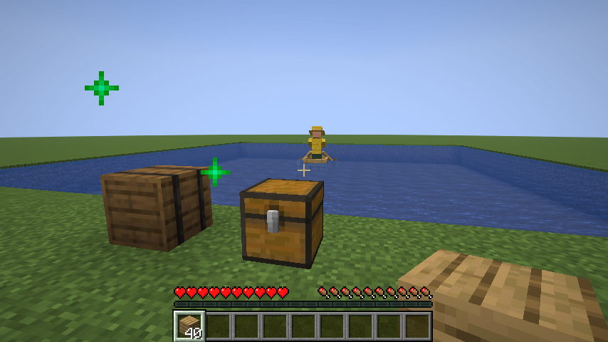

# Beruf: Fischer

[← Berufe](README.md) · Station: **Fass** (Vanilla) · Phase: **umgesetzt** (Ufer und Boot; ohne Räuchern und Master-Fähigkeit)

Der Fischer angelt am Wasser rund um sein Fass, vom Ufer aus oder draußen im Boot, und liefert den Fang für die geplante [Vorratskammer](../wirtschaft/beduerfnisse.md#vorratskammer).

## Workstation: Fass

- Das normale Vanilla-Fass, für Spieler weiter ein Lager. Über seinem Menü stehen die Reiter der Station (siehe [Steuerung](../grundlagen/steuerung.md#stationsübersicht)). Technisch: Das Fass öffnet ein Kisten-Menü; das Kisten-Menü bekommt einen Datenslot, der nur bei Fässern gefüllt wird (`ChestMenuMixin`), und der Kisten-Bildschirm zeichnet dann die Reiter.
- Vanilla-Fischer arbeiten weiter an Fässern, außer an eingerichteten. Ein Vanilla-Fischer lässt sich direkt anheuern und bleibt mit seinen Angeboten am Fass; der Fischer handelt wie ein Vanilla-Fischer.
- Kisten verknüpft man mit **„+ Kiste“**; er braucht nur Zielkisten.

## Stand der Umsetzung

- **Ufer:** Er sucht die nächste Uferstelle an Wasser im Umkreis von 16 Blöcken um das Fass (Config `fisher.waterRadius`, 4–32), bis 4 Blöcke höher oder tiefer. Wasser zählt ab einem kleinen Teich (mindestens 4 Wasserflächen im 5×5 um die Stelle). Er stellt sich ans Ufer und angelt.
- **Angeln:** ohne echten Schwimmer. Ein Biss kommt nach 5 bis 30 Sekunden (Config `fisher.minBiteSeconds`, `fisher.maxBiteSeconds`), Köder verkürzt wie in Vanilla. Partikel am Wasser zeigen den Schwimmer. Die Beute kommt aus den Vanilla-Angeltabellen (`gameplay/fishing/fish`, `junk`, `treasure`), gewichtet wie in Vanilla (85 : 10 : 5) mit Glück des Meeres. **Schätze nur auf offenem Wasser** (5×5 Wasser, zwei tief, um den Schwimmer), wie in Vanilla.
- **Boot:** Hat er ein Boot (Item-Tag `boats`) und ist die Bootsfahrt am Fass an (Reiter **Einstellungen**, Feld `boat` der Station), sucht er offenes Wasser: 7×7 Wasser, zwei tief, 6 bis 32 Blöcke vom Ufer (Config `fisher.seaRadius`), am liebsten etwa 14, und auf dem Weg nur Wasser. Dann setzt er das Boot am Ufer ein, steigt ein und rudert hinaus. Gesteuert wird das Boot direkt (Richtung und Geschwindigkeit jeden Tick, etwa so schnell wie ein Spieler). Draußen angelt er, nach 12 Fängen (Config `fisher.catchesPerTrip`) oder zum Feierabend rudert er zurück, steigt am Ufer aus, nimmt das Boot wieder an sich und liefert ab.
- **Nie draußen über Nacht:** Solange er im Boot sitzt, arbeitet er weiter, auch nach Feierabend, bis er wieder an Land ist. Kommt das Boot nicht voran, kehrt er um; hängt es auf dem Rückweg fest, steigt er aus und steht wieder an seiner Uferstelle (wie ein Teleport; das Boot nimmt er mit). Nach dem Neuladen im Boot rudert er zuerst zurück. Verliert er das Boot (zerstört, herausgestoßen), nimmt er es mit, wenn es nah ist.
- **Versorgung:** Lohn und eine **Angel** (bis zu 2), optional ein **Boot**. Normale Angeln gelten wie Scheren als billig und werden aufgebraucht (der Schmied kann sie nicht reparieren); **verzauberte oder umbenannte** gibt er kurz vor dem Bruch zurück wie jedes verzauberte Werkzeug, damit der Spieler sie am Amboss reparieren kann. Bricht eine Angel, bringt er den Fang erst zur Kiste. Beides holt er sich auch aus einer [Dorftruhe](../dorf/dorftruhen.md).
- **Abliefern:** alles außer Angeln, Boot und Lohn, nach 12 Fängen oder vollem Inventar.
- **Status im Menü:** „Geht ans Wasser“, „Angelt“, „Angelt im Boot“, „Rudert hinaus“, „Rudert mit dem Fang zurück“, „Wartet: kein Wasser in der Nähe des Fasses“, „Kommt nicht ans Wasser“, „Wartet: braucht eine Angel“, dazu „Heute gefangen: x“.
- **Kleidung:** gelber Südwester mit breiter Krempe, gelbe Öljacke über einem dunkelblauen Pullover, grüne Gummistiefel (`tools/generate_textures.py`).
- **Tests:** An einem Teich angelt er vom Ufer, der Fang landet in der Kiste. Von zwei fast kaputten Angeln braucht er die normale auf und gibt die verzauberte in die Kiste. An einem See mit Boot rudert er mehr als 5 Blöcke hinaus, kommt zurück, hat sein Boot wieder und liefert den Fang ab. Der Client-Test fotografiert ihn im Boot.
- **Nicht umgesetzt:** Fisch räuchern, ein sichtbarer Schwimmer, Master-Fähigkeit.

## Master-Fähigkeit

Konzept: mehr Glück beim Angeln (wie Glück des Meeres I).

## Siehe auch

[Metzger](metzger.md) · [Hirte](hirte.md)
