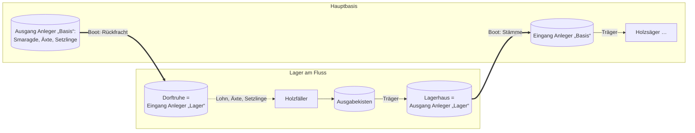

# Beruf: Fuhrmann

[← Berufe](README.md) · Station: **Verladestelle** (neu, an jedem Ende einer Strecke; als **Anleger** umgesetzt) · Phase: **Schiffer umgesetzt**, Säumer und Lorenfahrer Konzept (M4)

Der Fuhrmann bringt Items über lange Strecken von einer Verladestelle zur anderen und nimmt auf dem Rückweg Fracht mit, etwa Stämme aus einem abgelegenen Holzfällerlager zur Hauptbasis und Smaragde, Äxte und Setzlinge zurück. Er fährt mit dem Boot, führt eine Lama-Karawane oder schickt Kistenloren über Schienen.

## Beispiel: Holzfällerlager am Fluss

Für die Bezahlung braucht es keine neue Regel: Holzfäller nehmen Lohn, Ersatzäxte und Setzlinge schon heute aus [Dorftruhen](../dorf/dorftruhen.md) in ihrer Nähe und geben abgenutzte Äxte dorthin zurück ([Werkzeugrückgabe](../dorf/werkzeugrueckgabe.md)). Ist der Eingang im Lager eine Dorftruhe, kommt der Lohn mit dem Boot an. Abgenutzte Äxte fahren in der Gegenrichtung zum [Schmied](schmied.md).

Ein Kistenboot fasst 27 Stacks (1.728 Stämme), mehr als einige Holzfäller an einem Tag fällen. Eine Fahrt pro Tag genügt.

## Drei Arten

Die Art ergibt sich wie beim [Fischer](fischer.md) aus dem, was der Fuhrmann als Vorrat hat.

| Art | Vorrat | Ladung pro Fahrt | Tempo |
| --- | --- | --- | --- |
| **Schiffer** (Boot) | Kistenboot | 27 Slots; mit einem zweiten Boot an der Leine 54 (falls die Zielversion Boote an die Leine lässt) | etwa 3,5 Blöcke/s |
| **Säumer** (Lama) | Leine und gezähmte Lamas mit Kiste | 3–15 Slots je Lama (nach Stärke), Karawane bis 10 Lamas | Schritttempo |
| **Lorenfahrer** (Lore) | Kistenloren; die Schienen liegen schon | 27 Slots je Lore, mehrere nacheinander | schnell |

### Schiffer

- Setzt das Kistenboot an der Verladestelle aufs Wasser, belädt es und rudert die Strecke ab. Rudern, Einsteigen und die Suche nach dem Ufer gibt es schon beim Fischer (`GoFishing`).
- Flüsse liegen fast überall auf Meereshöhe; flussaufwärts gegen einen Wasserfall geht es nicht. Solche Stellen kann die Strecke nicht enthalten, weil der Spieler sie beim [Abfahren](#strecke-einmal-selbst-abfahren) selbst nicht schafft.

### Säumer

- Führt das erste Lama an der Leine; die übrigen folgen als Vanilla-Karawane, wie beim Fahrenden Händler.
- Die Stärke der Lamas bestimmt die Ladung. Das Züchten starker Lamas lohnt sich damit.
- Das wackligste Stück: Im Gelände bleiben Lamas an Bäumen und Zäunen hängen, und eine Leine reißt ab 10 Blöcken Abstand. Ein Lama, das zurückfällt, wird zum Säumer zurückgesetzt.

### Lorenfahrer

- Dorfbewohner können in Vanilla keine Lore ziehen, und Loren lassen sich nicht koppeln. Der Lorenfahrer arbeitet deshalb als Bahnwärter: Er belädt die Kistenloren, schickt sie per Antriebsschiene los und entlädt sie am anderen Ende.
- Unter Tage ist das die Schienenstrecke des [Grubenlogistikers](grubenlogistiker.md#stufe-2-schiene-und-lore) (Stufe 2). Der Grubenlogistiker baut die Strecke, der Lorenfahrer betreibt sie; über Tage verlegt der Spieler die Schienen selbst.
- Eine Aufnahme der Strecke braucht er nicht: Die Schienen sind die Strecke.

## Workstation: Verladestelle

- Neuer Block, an jedem Ende einer Strecke einer. Name und Aussehen je nach Art: Anleger, Lamastall oder Bahnhof.
- Wie bei anderen Stationen gehören zu jeder Verladestelle verknüpfte Kisten: **Ausgang** (wird mitgenommen) und **Eingang** (hier wird abgeladen).
- Eine **Fernroute** verbindet zwei Verladestellen, mit Art, Wegpunkten und Länge. Datenmodell und Menü übernehmen viel vom [Träger](traeger.md#transportwege) (`carrier/Route`).
- Ein Fuhrmann bedient eine Fernroute; ab einem höheren Level vielleicht zwei.

## Strecke einmal selbst abfahren

Vanilla-Pathfinding reicht nicht über 300 Blöcke und findet keinen Weg einen Fluss entlang. Deshalb nimmt der Spieler die Strecke auf:

- Der Spieler benutzt das **Frachtbuch** an der ersten Verladestelle, fährt die Strecke einmal ab (das Buch im Inventar) und benutzt es an der zweiten. Alle etwa 16 Blöcke entsteht ein Wegpunkt, dazu einer vor jeder Biegung (wo die gerade Linie vom letzten Wegpunkt das Wasser verlassen würde).
- Der Fuhrmann fährt danach gerade Linien von Wegpunkt zu Wegpunkt, so wie der Fischer heute zu seinem Fangplatz rudert.
- Die Strecke ist damit befahrbar, weil der Spieler sie selbst befahren hat. Die Summe der Abschnitte ergibt die Fahrzeit für die [gerechnete Fahrt](#echte-und-gerechnete-fahrt).
- Bleibt der Fuhrmann unterwegs stecken (Brücke gebaut, Fluss zugeschüttet), erkennt das die Rückholung festgesteckter Arbeiter (`StuckWorkers`). Der Status lautet dann „Strecke blockiert, bitte neu aufnehmen“.

## Echte und gerechnete Fahrt

Arbeiter arbeiten nur in geladenen Chunks. Das löst das [Chunk-Loading](../dorf/chunk-loading.md), das es schon gibt: Ein Fuhrmann, der [ohne Spieler arbeitet](../dorf/chunk-loading.md#einschalten), trägt sein Chunk-Ticket mit sich und lädt die Strecke Stück für Stück, während er fährt. Die Fahrt ist damit **immer echt**, auch wenn kein Spieler in der Nähe ist. Die Kosten bleiben klein: 3×3 Chunks um den Fuhrmann statt eines geladenen Korridors.

- Beide Verladestellen gehören zu seinem [Arbeitsplatz](../dorf/chunk-loading.md#der-arbeitsplatz) und bleiben geladen, auch während er unterwegs ist.
- Das Lager selbst arbeitet ohne Spieler, wenn die Holzfäller dort ebenfalls ohne Spieler arbeiten.
- Was beim Schiffer zu prüfen bleibt: Das Laden der Chunks muss mit dem Boot mithalten (etwa 3,5 Blöcke/s, ein neuer Chunk alle 4–5 Sekunden; eine Enderperle ist schneller).

Die **gerechnete Fahrt** braucht es nur noch als Notbehelf für Server, die Chunk-Loading abschalten (`chunkLoading.enabled: false`):

1. **Im geladenen Bereich** fährt er sichtbar, mit Boot, Karawane oder Lore.
2. **Erreicht er den Rand**, wird er mit Fahrzeug, Tieren und Ladung aus der Welt genommen und als „unterwegs“ gespeichert. Die Ankunftszeit folgt aus der restlichen Streckenlänge und dem Tempo der Art.
3. **Ist die Zeit um** und das Ziel geladen, taucht er am Rand des geladenen Bereichs auf der Strecke wieder auf und fährt den Rest sichtbar. Ist das Ziel nicht geladen, wartet er „unterwegs“.

Denselben Mechanismus braucht der [Händler](haendler.md#reise) für Reisen zu Nachbardörfern, die weit weg und nicht geladen sind.

## Lohn und Arbeitszeit

- Wie alle Arbeiter nimmt er seinen Tageslohn vor der ersten Fahrt, aus der Lohnkasse seiner Verladestelle oder einer Dorftruhe in der Nähe.
- Er fährt nur tagsüber: Nachts greifen Ertrunkene auf dem Fluss und Monster an Land an. Eine Fahrt, die nicht mehr vor Einbruch der Nacht ankommt, beginnt er nicht.

## Stand der Umsetzung

Umgesetzt ist Schritt 1: die Fernroute mit Frachtbuch und der **Schiffer** (Beruf `hauler`, Code in `HaulCargo`, Strecke in `Voyage` und `VoyageRecorder`).

- **Anleger** (Block `jetty`): ein Poller mit Tau am Wasser, an jedem Ende einer. Eingänge sind die Fracht, Ausgänge nehmen auf, was ankommt. Rezept: Faden über zwei Stämmen.
- **Frachtbuch** (Item `freight_book`, Buch + Kompass): am ersten Anleger benutzen, mit dem Boot zum zweiten rudern, dort benutzen. Das Buch glänzt, solange es aufnimmt; über der Schnellleiste stehen Länge und Wegpunkte. Am ersten Anleger noch einmal benutzt, bricht es ab. Das Boot muss an beiden Enden höchstens 16 Blöcke vom Anleger liegen. Beide Anleger bekommen die Strecke, der zweite in Gegenrichtung; ein Fuhrmann an jedem der beiden fährt sie. Die Aufnahme lebt nur bis zum Neustart des Servers.
- Die Strecke ist höchstens `hauler.maxRouteLength` Blöcke lang (Vorgabe 512, bis 768), damit Hin- und Rückfahrt an einem Tag gehen.
- **Ablauf:** Am Anleger setzt der Fuhrmann sein Kistenboot dort aufs Wasser, wo der Spieler eingestiegen ist, belädt es aus den Eingängen (27 Stapel), rudert die Wegpunkte ab (0,18 Blöcke pro Tick wie der Fischer), entlädt am anderen Anleger in die Ausgänge, belädt aus den Eingängen dort und rudert zurück. Er fährt auch leer los, wenn am anderen Anleger etwas wartet. Ist nichts mehr zu fahren, holt er das Boot aus dem Wasser.
- **Tageszeit:** Er fährt nur los, wenn er vor der Dämmerung (Tageszeit 12000) wieder zurück ist. Einmal losgefahren, hört er am Ende der Arbeitszeit nicht auf, sondern kommt erst heim. Ein beladenes Boot, für das die Zeit nicht mehr reicht, bleibt über Nacht vertäut.
- **Volle Ausgänge:** Er wartet am Ziel, bis Platz ist, und nimmt nichts zurück. Damit nach dem Laden nichts wieder ausgeladen wird, merkt sich der Anleger, ob noch entladen wird.
- **Speichern:** Boot und Abschnitt der Fahrt (daheim, hin, drüben, zurück) stehen am Anleger. Ein Fuhrmann, der im Boot neu geladen wird, rudert in der richtigen Richtung weiter.
- **Chunk-Loading:** Der andere Anleger mit seinen Kisten gehört zum Arbeitsplatz; unterwegs trägt der Fuhrmann sein Ticket mit sich. Ist die Strecke vor ihm nicht geladen, wartet er auf dem Wasser.
- **Festgefahren:** Kommt das Boot nicht voran, nimmt er den nächsten Wegpunkt; hilft das nicht, sagt sein Status „Steckt unterwegs fest“. Die Rückholung festgesteckter Arbeiter (`StuckWorkers`) greift im Boot nicht.
- Getestet mit dem Game-Test `hauler_rows_cargo_both_ways` (Kanal, zwei Anleger, Fracht hin und zurück, Boot wieder eingepackt).

Noch offen:

1. Die gerechnete Fahrt, nur für Server ohne Chunk-Loading.
2. **Säumer**.
3. **Lorenfahrer**, zusammen mit dem [Grubenlogistiker](grubenlogistiker.md).
4. Zweites Boot an der Leine und zwei Fernrouten (Master-Fähigkeit), Berufsbuch.

## Master-Fähigkeit

Bedient zwei Fernrouten oder nimmt beim Schiffer ein zweites Boot, beim Säumer mehr Lamas mit.

## Sonderfälle & offene Fragen

- **Verlust beim Speichern „unterwegs“** (nur bei der gerechneten Fahrt): Stürzt der Server ab, während der Fuhrmann aus der Welt genommen und noch nicht gespeichert ist, sind er oder die Ladung weg, oder sie sind doppelt da. Das Herausnehmen und Speichern muss in einem Schritt geschehen.
- Stirbt der Fuhrmann unterwegs (echte Fahrt), fallen Ladung und Fahrzeug an Ort und Stelle zu Boden. Auf der gerechneten Fahrt stirbt er nicht.
- Eingang am Ziel voll: Er wartet an der Verladestelle, wie der Träger an einer vollen Zielkiste.
- Darf eine Strecke mehr als zwei Verladestellen haben (Zwischenhalte)?
- Ein Beruf mit drei Arten oder drei Berufe? Ein Beruf hält die Liste kurz und passt zu Fischer und Boot.

## Berufsbuch

Offen; naheliegend ist der Kartograf.

## Siehe auch

[Träger](traeger.md) · [Grubenlogistiker](grubenlogistiker.md) · [Händler](haendler.md) · [Fischer](fischer.md) · [Logistik](../grundlagen/logistik.md) · [Chunk-Loading](../dorf/chunk-loading.md) · [Dorftruhen](../dorf/dorftruhen.md)
