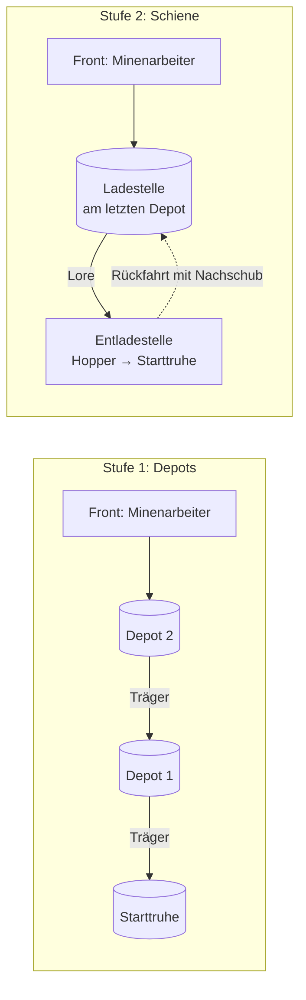

# Beruf: Grubenlogistiker

[← Berufe](README.md) · Station: **Förderhaspel** (neu, am Stolleneingang) · Phase: **M4**

Der Grubenlogistiker hält lange Stollen produktiv. Er baut neue Depot-Truhen am Ende des Stollens, organisiert die Träger zwischen den Depots und verlegt später eine Schienenstrecke, auf der eine Lore Erz und Stein automatisch nach draußen fährt.

## Das Problem

Ein [Minenarbeiter](minenarbeiter.md) gräbt seinen Stollen immer tiefer. Je weiter er von der Starttruhe entfernt ist, desto mehr Zeit verbringt er mit Laufen statt mit Graben. Ohne Logistiker endet ein Stollen deshalb bei der Reichweite der Station (z. B. 32–48 Blöcke); danach meldet der Minenarbeiter „Wartet: Weg zu weit“ im [Dorfbuch](../dorf/dorfbuch.md).

## Ausbaustufen

| Stufe | Was der Logistiker baut | Transport | Benötigt |
| --- | --- | --- | --- |
| 0 – ohne Logistiker | nichts | Minenarbeiter läuft selbst zur Starttruhe | – |
| 1 – Depots | Alle n Blöcke eine Depot-Truhe in einer Seitennische | [Träger](traeger.md) tragen von Depot zu Depot | Truhen, Fackeln |
| 2 – Schiene | Schienenstrecke von der Front zur Starttruhe, Lade- und Entladestelle | Kistenlore pendelt automatisch | Schienen, Antriebsschienen, Redstone-Fackeln, Hopper, Kistenlore |
| 3 – Aufzug (Etagenmine) | Förderkorb im Schacht, Ladestelle an jedem Füllort | Korb fährt zwischen Füllorten und Starttruhe | Ketten, Eisen, Bretter; später Blasensäule mit Seelensand |

In der [Etagenmine](../grundlagen/mine.md) arbeitet er genauso, nur auf jeder Etage getrennt, dazu der Aufzug zwischen den Etagen (Stufe 3). Dort bestimmt er auch die Größe der Mine: Ohne ihn ist sie 3×3 Chunks groß, mit Depots und Trägern 5×5. Jede Lorenroute (Schiene im Hauptgang einer Richtung) fügt in dieser Richtung eine Chunk-Reihe hinzu, mit allen vier Routen 7×7 (siehe [Größe der Mine](../grundlagen/mine.md#größe-der-mine-ausbau-mit-dem-logistiker)).

Stufe 2 ersetzt Stufe 1 nicht sofort: Solange die Schiene noch nicht bis zur Front reicht, überbrücken Träger das letzte Stück.

## Stufe 1: Depots

- Sobald der Minenarbeiter weiter als z. B. 32 Blöcke vom letzten Depot entfernt arbeitet, holt der Logistiker eine Truhe und Fackeln und baut ein neues Depot.
- Das Depot steht in einer seitlichen Nische (1 Block tief), damit der Stollen frei bleibt, und bekommt eine Fackel.
- Ist das neue Depot fertig, nutzen die Minenarbeiter nur noch dieses: Es wird automatisch ihre Zielkiste und ihre Quelle für Fackeln und Werkzeug. Zum alten Depot laufen sie nicht mehr. Das alte Depot wird zur reinen Umschlagstation für die Träger (bzw. später zur Ladestelle der Lore, falls es das letzte vor der Front bleibt).
- Der Logistiker trägt jedes neue Depot automatisch in die Routen der zugeordneten [Träger](traeger.md) ein: Jeder Träger bedient einen Abschnitt (Depot n → Depot n−1), wie eine Eimerkette.
- Die Reichweitenregel (Kisten standardmäßig max. 16, per Config höchstens 32 Blöcke von der Station, siehe [Steuerung](../grundlagen/steuerung.md#grenzen)) gilt im Stollen ab dem jeweils letzten Depot. Depots verlängern also die Reichweite der Mine.

## Stufe 2: Schiene und Lore

Liegen die Materialien in der Quellkiste der Förderhaspel, verlegt der Logistiker eine echte Vanilla-Schienenanlage. Alles, was er baut, ist ein normaler Redstone-Bau, den der Spieler sehen, verstehen und selbst reparieren kann.

- **Strecke:** Schienen auf dem Stollenboden von der Entladestelle am Eingang bis zur Ladestelle am letzten Depot. Antriebsschienen mit Redstone-Fackel in regelmäßigen Abständen (Abstand für eine beladene Kistenlore im Prototyp ermitteln).
- **Ladestelle (Front):** Der Logistiker oder ein Träger füllt die Kistenlore aus dem Depot und schickt sie per Hebel bzw. Knopf an einer Antriebsschiene los.
- **Entladestelle (Eingang):** Die Lore hält über einem Hopper, der in die Starttruhe entlädt; ein Detektor- bzw. Antriebsschienen-Aufbau schickt sie leer zurück (klassischer Vanilla-Pendelbahnhof).
- **Rückfracht:** Auf dem Rückweg nimmt die Lore Nachschub mit, z. B. Fackeln, Spitzhacken und Bruchstein für den Minenarbeiter. Eine Kiste an der Entladestelle dient als Nachschub-Quelle.
- **Mitwachsen:** Gräbt der Minenarbeiter weiter, verlängert der Logistiker die Strecke und versetzt die Ladestelle ans neue letzte Depot. Fehlen Schienen, übernehmen Träger das Stück dazwischen.

## Stufe 3: Aufzug in der Etagenmine

- An jedem Füllort baut der Logistiker eine Ladestelle mit Depot.
- Der Förderkorb hängt an Ketten im Schacht, wird von der Förderhaspel angetrieben und hält nacheinander an jedem Füllort.
- Nach oben fährt Erz, nach unten Nachschub (Fackeln, Werkzeug, Holz für Stützen).
- Neue Etage → der Logistiker verlängert die Kette und richtet den neuen Füllort ein.
- Alternativen (Leiter + Träger, Blasensäule, vom Spieler gebauter Aufzug) und Details: [Die Mine](../grundlagen/mine.md#aufzug-zwischen-den-etagen).

## Quellkiste / Zielkiste

| Quellkiste (an der Förderhaspel) | Zielkiste |
| --- | --- |
| Truhen, Fackeln, Schienen, Antriebsschienen, Redstone-Fackeln, Hopper, Kistenloren, Hebel, Ketten für den Förderkorb | keine eigene; er baut die Depots und die Starttruhe wird über die Lore befüllt |

## Workstation: Förderhaspel

- Neuer Block am Stolleneingang (Idee: Bretter + Kette + Eisenbarren), thematisch eine Seilwinde.
- Ist der POI des Logistikers und gehört zur [Grubenwerkbank](minenarbeiter.md) daneben: Eine Mine besteht aus Grubenwerkbank (Minenarbeiter), Förderhaspel (Logistiker) und Starttruhe.
- Das GUI zeigt die Mine im Längsschnitt: Stollenlänge, Depots, Schienenabdeckung in Prozent und fehlende Materialien („Braucht: 14 Schienen, 2 Antriebsschienen“).

## Master-Fähigkeit

Baut Weichen für die Abzweige im Stollen-Modus, sodass eine Strecke mehrere Stollen bedient.

## Status im Dorfbuch

| Status | Bedeutung |
| --- | --- |
| Baut Depot | ein neues Depot wird angelegt |
| Verlegt Schiene | Strecke wird verlängert, mit Fortschritt (z. B. 48/80 Blöcke) |
| Braucht: Material | Truhen, Schienen oder Redstone fehlen |
| Blockiert: Strecke unterbrochen | Schiene fehlt oder Lore hängt fest |

## Chunk-Loading

Ein langer Stollen reicht durch viele Chunks. Damit die Lore nicht in einem entladenen Chunk stehen bleibt, lädt die Mine alle Chunks entlang der registrierten Strecke und mit Depots (siehe [Chunk-Loading](../dorf/chunk-loading.md)). Das kostet Unterhalt pro Chunk: Ein 256 Blöcke langer Stollen sind rund 16 Chunks. Das ist gewollt, denn so wird eine lange Bahn eine bewusste wirtschaftliche Entscheidung.

Die [Etagenmine](../grundlagen/mine.md#warum-etagen) vermeidet das Problem: Sie bleibt in einer festen Grundfläche (3×3, 5×5, bis 7×7), und zusätzliche Etagen kosten keine zusätzlichen Chunks.

Fallback, wenn Chunk-Loading per Config aus ist: Die Lore-Fahrt wird abstrahiert (Ankunft nach berechneter Fahrzeit), sobald ein Chunk der Strecke nicht geladen ist.

## Sonderfälle & offene Fragen

- Lava, Wasser oder Höhlen kreuzen die Strecke: Der Logistiker überbrückt mit Bruchstein, so wie der Minenarbeiter abdichtet.
- Mobs auf der Strecke können Loren blockieren; Fackeln entlang der Schiene verhindern Spawns.
- Schacht-Modus (Treppe nach unten): Schienen nur auf geraden oder schrägen Stücken; ein steiler Schacht braucht stattdessen Träger oder eine Wasserleitung/Item-Aufzug (später).
- Soll der Logistiker auch Depots ohne Träger leeren, indem er selbst trägt, solange keine Träger zugeordnet sind?
- Eigener Block Förderhaspel oder Zuordnung als zweiter Arbeiter an der Grubenwerkbank?

## Siehe auch

[Die Mine](../grundlagen/mine.md) · [Minenarbeiter](minenarbeiter.md) · [Träger](traeger.md) · [Logistik](../grundlagen/logistik.md) · [Chunk-Loading](../dorf/chunk-loading.md)
