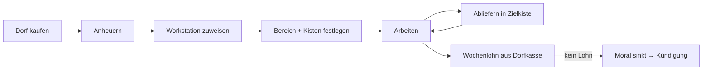

# Kernloop

[← Wiki-Start](../README.md)

Der Spieler stellt ein, weist zu, versorgt und bezahlt; der Dorfbewohner arbeitet. Jeder Job folgt demselben Schema, nur die Arbeit am Arbeitsort unterscheidet sich.

Die Seite beschreibt das **Konzept**. Was davon schon im Spiel ist, steht unten unter [Stand der Umsetzung](#stand-der-umsetzung).

1. **Anheuern:** [Dorf kaufen](../dorf/dorf-und-kauf.md), dann Rechtsklick mit einem Arbeitsvertrag auf einen seiner Dorfbewohner. Erste Wochenmiete wird sofort fällig. Details: [Anheuern & Lohn](../wirtschaft/anheuern-und-lohn.md).
2. **Zuweisen:** Der Angestellte wird einer Workstation zugewiesen. Die Workstation bestimmt den Beruf (Hackklotz → [Holzfäller](../berufe/holzfaeller.md), Holzsäge → [Holzsäger](../berufe/holzsaeger.md), Grubenwerkbank → [Minenarbeiter](../berufe/minenarbeiter.md)).
3. **Konfigurieren:** An der Workstation werden Arbeitsbereich, Quellkiste (Werkzeug, Setzlinge, Fackeln) und Zielkiste (Ertrag) festgelegt (siehe [Steuerung](steuerung.md)).
4. **Arbeiten:** Während der Arbeitszeit (Vanilla-Arbeitsphase der Villager, ca. Tick 2000–9000, konfigurierbar) holt er sich Material, arbeitet im Bereich und liefert ab.
5. **Abliefern:** Ertrag landet in der Zielkiste. Ist sie voll, wartet er und zeigt ein Sprechblasen-Symbol.
6. **Bezahlen:** Lohn wird wöchentlich (7 Ingame-Tage) aus der [Dorfkasse](../dorf/dorf-und-kauf.md#dorfkasse) abgebucht. Ohne Lohn sinkt die Moral, am Ende kündigt er.

**Grundregel für alle Berufe:** Arbeiter verlassen den Arbeitsbereich nur für den Weg zu Quell- und Zielkiste, Bett, Vorratskammer und Glocke. Nachts schlafen sie wie Vanilla-Villager.

## Stand der Umsetzung

1. **Anheuern:** Arbeitsvertrag aus Papier, Tintenbeutel und 3 Emeralds craften, Rechtsklick auf einen erwachsenen Dorfbewohner; einer mit Beruf bleibt an seinem Block, sofern es dort Arbeit dieser Mod gibt und er noch nicht gehandelt hat. Einen Dorfkauf und eine Anheuergebühr gibt es nicht.
2. **Zuweisen:** Der Angestellte sucht sich selbst eine freie Station im Umkreis von 48 Blöcken, oder man weist ihn in der [Stationsübersicht](steuerung.md#stationsübersicht) zu. Die Station bestimmt den Beruf: Hackklotz → Holzfäller, Holzsäge → Holzsäger, Steinsäge → Steinsäger, Hobelbank → Tischler, Komposter → Bauer, Webstuhl → Hirte, Räucherofen → Metzger, Schmelzofen und Schmiedetisch → Schmied. Der Träger bekommt statt einer Station den Weidenkorb.
3. **Konfigurieren:** Kisten als Eingang bzw. Ausgang verknüpfen und, wo nötig, einen Auftrag wählen. Arbeitsbereiche gibt es nicht; Werkzeug und Setzlinge bzw. Saatgut gibt man dem Arbeiter direkt.
4. **Arbeiten:** in der normalen Vanilla-Arbeitszeit der Dorfbewohner.
5. **Abliefern:** in die Ausgangskisten. Sind sie voll, wartet er; der Status steht in der Stationsübersicht. Statt einer Sprechblase schüttelt er ab und zu den Kopf mit dem „Nein“-Sound, wenn ein Spieler in der Nähe ist.
6. **Bezahlen:** 1 Emerald pro Arbeitstag (Config) aus den Emeralds, die er bei sich trägt. Ohne Lohn wartet er, Moral und Kündigung gibt es noch nicht.

Details: [Anheuern & Lohn – Stand der Umsetzung](../wirtschaft/anheuern-und-lohn.md#stand-der-umsetzung).
