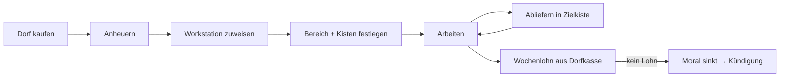

# Kernloop

[← Wiki-Start](../README.md)

Der Spieler stellt ein, weist zu, versorgt und bezahlt; der Dorfbewohner arbeitet. Jeder Job folgt demselben Schema, nur die Arbeit am Arbeitsort unterscheidet sich.

1. **Anheuern:** [Dorf kaufen](../dorf/dorf-und-kauf.md), dann Rechtsklick mit einem Arbeitsvertrag (Papier + Emerald) auf einen seiner Dorfbewohner. Erste Wochenmiete wird sofort fällig. Details: [Anheuern & Lohn](../wirtschaft/anheuern-und-lohn.md).
2. **Zuweisen:** Der Angestellte wird einer Workstation zugewiesen. Die Workstation bestimmt den Beruf (Woodcutter → [Holzfäller](../berufe/holzfaeller.md), Grubenwerkbank → [Minenarbeiter](../berufe/minenarbeiter.md)).
3. **Konfigurieren:** An der Workstation werden Arbeitsbereich, Quellkiste (Werkzeug, Setzlinge, Fackeln) und Zielkiste (Ertrag) festgelegt (siehe [Steuerung](steuerung.md)).
4. **Arbeiten:** Während der Arbeitszeit (Vanilla-Arbeitsphase der Villager, ca. Tick 2000–9000, konfigurierbar) holt er sich Material, arbeitet im Bereich und liefert ab.
5. **Abliefern:** Ertrag landet in der Zielkiste. Ist sie voll, wartet er und zeigt ein Sprechblasen-Symbol.
6. **Bezahlen:** Lohn wird wöchentlich (7 Ingame-Tage) aus der [Dorfkasse](../dorf/dorf-und-kauf.md#dorfkasse) abgebucht. Ohne Lohn sinkt die Moral, am Ende kündigt er.

**Grundregel für alle Berufe:** Arbeiter verlassen den Arbeitsbereich nur für den Weg zu Quell- und Zielkiste, Bett, Vorratskammer und Glocke. Nachts schlafen sie wie Vanilla-Villager.
