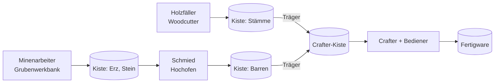

# Logistik & Weiterverarbeitung

[← Wiki-Start](../README.md)

Arbeiter sprechen nie direkt miteinander, sondern nur über Kisten. Dadurch lässt sich jede Verbindung wahlweise durch einen [Träger](../berufe/traeger.md), einen Hopper oder eine Lore herstellen, und Vanilla-Redstone bleibt voll nutzbar.

Rohstoffe fließen von links nach rechts; der Crafter ist der einzige Punkt, an dem mehrere Ketten zusammenlaufen. Jeder Pfeil zwischen Kisten kann ein Träger, Hopper oder eine Lore sein.

## Beteiligte Berufe

- [Träger](../berufe/traeger.md): bewegt Items zwischen Kisten nach Route und Filter.
- [Crafter-Bediener](../berufe/crafter-bediener.md): befüllt und bedient einen Vanilla-Crafter.
- [Schmied](../berufe/schmied.md): schmilzt Erz zu Barren.
- [Grubenlogistiker](../berufe/grubenlogistiker.md): baut Depots, Schienen mit Lore und den Aufzug der [Etagenmine](mine.md).

## Crafter-Integration (Vanilla-Crafter ab 1.21)

- Der Crafter kann bereits automatisch craften, braucht aber befüllte Slots und ein Redstone-Signal.
- Variante A (ohne Arbeiter): Hopper füllen den Crafter, ein Clock löst aus. Funktioniert schon heute mit den Ausgabekisten.
- Variante B ([Crafter-Bediener](../berufe/crafter-bediener.md)): Ein Angestellter liest das Rezept aus dem gesperrten Slot-Muster des Crafters, füllt die Slots aus der Crafter-Kiste und löst aus.
- Ausgabe wirft der Crafter in eine davor stehende Kiste oder einen Hopper.

## Beispielkette Holz

[Holzfäller](../berufe/holzfaeller.md) → Kiste Stämme → Woodcutter-Bediener (Bretter) → Crafter (Kisten, Zäune) → Verkauf über [Handelsangestellten](../berufe/handelsangestellter.md). Drei Angestellte, null Handarbeit.

Verarbeitete Waren bringen beim Verkauf deutlich mehr als Rohstoffe (siehe [Einnahmen](../wirtschaft/einnahmen.md)).
