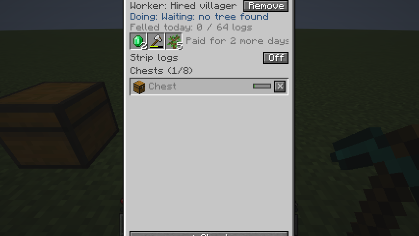
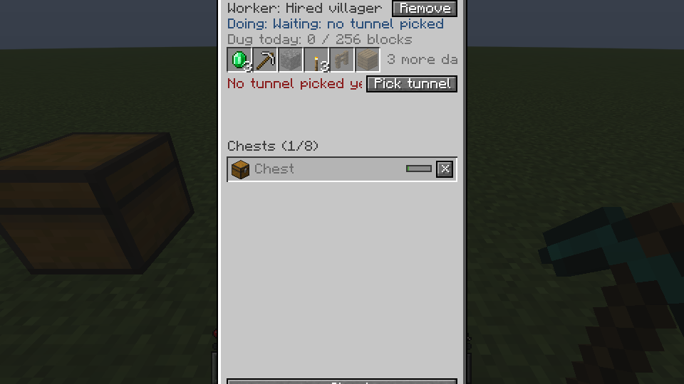
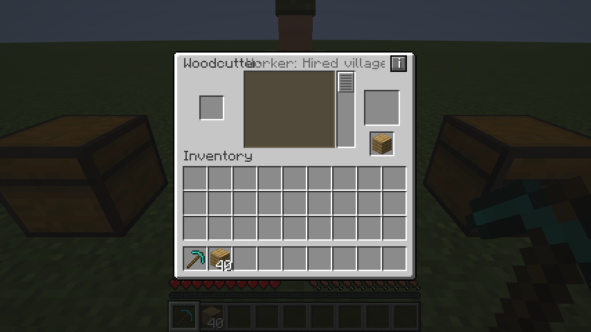
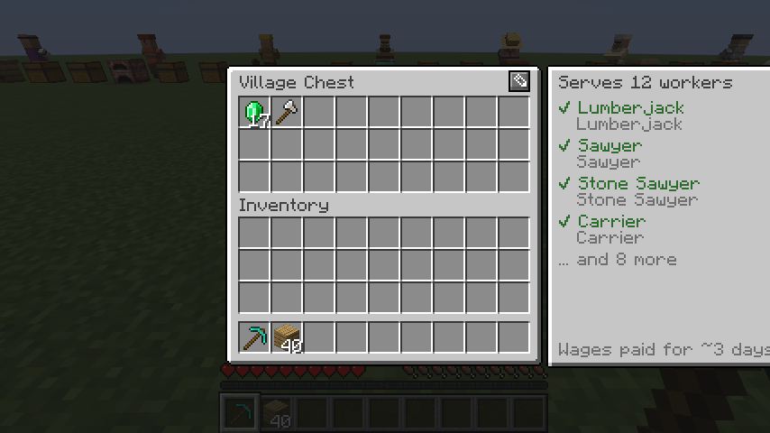

# Menüs überarbeiten

[← Wiki-Start](../README.md) · Phase: **Konzept** (Wunsch vom 18.10.2026) · ersetzt bei Umsetzung die [Stationsübersicht](../grundlagen/steuerung.md#stationsübersicht) in ihrer heutigen Form

Die Menüs sollen **in jedes Fenster passen**, **wie Vanilla aussehen und sich so bedienen**, und **einfacher** werden. Heute ragen manche über den Bildschirm hinaus, Texte überlagern sich, und der Weg vom Arbeitsmenü eines Blocks zu Arbeiter und Kisten führt über einen kleinen Knopf **i**, den man nicht versteht.

## Befund

Aufgenommen mit `./gradlew :fabric:runClientGameTest` (siehe [Screenshots](#screenshots)): jede Station mit Arbeiter, Kisten und Vorräten, in 854×480 und 1920×1080, GUI-Größe automatisch. Die Fläche, die ein Menü dann hat: **427×240** bei 854×480, **480×270** bei 1920×1080.

| # | Problem | Wo | Ursache |
| --- | --- | --- | --- |
| 1 | **Menü höher als der Bildschirm:** oben fehlt der Titel, unten der Knopf „+ Kiste“ | Übersicht von Hackklotz, Komposter, Grubenpflock, Grubenwerkbank, Handelstresen, Schmiedetisch: **auch bei 1920×1080** | Platz für 8 Kisten ist immer reserviert: 272 bis 303 px hoch, verfügbar 240 bzw. 270 |
| 2 | Menü höher als der Bildschirm | Träger | Wege, Versorgung, Korb und Inventar untereinander |
| 3 | **Text außerhalb des Menüs:** das Seitenfeld ragt über den rechten Rand, „Wages paid…“ ist angeschnitten | Dorftruhe | Feld (132 px) hängt rechts an der zentrierten Truhe |
| 4 | **Texte überlagern sich:** Titel und „Worker: …“ in einer Zeile · *behoben*: die Titelzeile zeigt den Arbeiter nicht mehr | Holzsäge, Steinsäge, Mühle, Hobelbank | Arbeitername in der Titelzeile |
| 5 | Titel „Carrier Carrier“ läuft in den Knopf „Employer only“ | Träger | Name und Knopf in einer Zeile |
| 6 | **Knopf „i“ ist nicht zu verstehen**; zurück geht es mit „Back“ oben rechts · *teilweise behoben*: statt „i“ ein Knopf mit dem Gesicht des Berufs (siehe [Steuerung](../grundlagen/steuerung.md#stationsübersicht)) | Holzsäge, Steinsäge, Hobelbank, Schmelzofen, Brennofen, Mühle, Schmiedetisch | zwei getrennte Menüs, verbunden über ein Symbol ohne Text |
| 7 | Abgeschnittene Zeilen und Lauftext: „Doing: Cannot work (chest or or…“, „aid for 2 more days“ hinter den Slots, „No tunnel picked ye“ | fast alle Übersichten | 162 px Breite für lange Sätze |
| 8 | Viel leere Fläche, dafür alles andere gedrängt | einspaltige Übersichten | siehe 1 |
| 9 | Alle unbenannten Kisten heißen „Chest“ und sind nicht zu unterscheiden | Übersichten, Träger | Hinweis zum Benennen nur im Tooltip |
| 10 | Beruf doppelt („Lumberjack / Lumberjack“), wenn der Arbeiter keinen Namen hat | Dorftruhe | Name fällt auf den Beruf zurück |
| 11 | Viele Textfarben (blau, rot, grün, grau) und Textknöpfe; wirkt nicht wie Vanilla | Übersichten | eigene Gestaltung |

 

 

## Leitlinien

1. **Passt immer.** Jedes Menü passt in **427×240** (854×480 bei GUI-Größe 2), samt Reitern. Nichts wird außerhalb des Fensterrahmens gezeichnet. Die Screenshots in 854×480 sind die Abnahme.
2. **Vanilla-Maße und -Bausteine.** Fenster **176 px** breit wie jede Vanilla-Kiste; Titel bei (8, 6) in Vanilla-Grau; Vanilla-Slots, -Knöpfe, -Scrollleiste, -Reiter. Keine selbst gezeichneten Farbflächen.
3. **Ein Muster für alles: Reiter.** Wie im Kreativinventar und bei den Fortschritten: Reiter mit Symbol über dem Fenster, Name im Tooltip. Kein Knopf „i“, kein „Back“.
4. **Kurz statt Lauftext.** Wichtiges passt in eine Zeile oder wird auf zwei umgebrochen; Erklärungen stehen im Tooltip. Lauftext höchstens noch für lange Namen.
5. **Farbe nur für Probleme.** Text in Vanilla-Grau; was den Arbeiter aufhält, in Rot mit einem kleinen Warnsymbol. Kein Blau und kein Grün für Normalzustände.
6. **Leere Zustände erklären.** „Noch kein Arbeiter“ mit dem Weg dorthin, statt einer leeren Zeile.

## Neuer Aufbau: Reiter

Jede Station hat bis zu drei Reiter über dem Fenster:

| Reiter | Symbol | Inhalt | Gibt es bei |
| --- | --- | --- | --- |
| **Block** | der Block selbst | das bisherige Arbeitsmenü des Blocks, unverändert (Steinsäge, Ofen, Schmiedetisch …) | Holzsäge, Steinsäge, Hobelbank, Schmelzofen, Brennofen, Grubenwerkbank (Mühle), Schmiedetisch |
| **Arbeit** | Kopf des Berufs (ohne Arbeiter: Arbeitsvertrag) | Arbeiter, Zustand, Versorgung, Kisten | allen Stationen |
| **Auftrag** | was bestellt ist, sonst ein Papier | Erzeugnis, Holzsorten, Vorrat; Stationseinstellungen | Holzsäge, Steinsäge, Hobelbank, Brennofen, Hackklotz (Entrinden), Grubenpflock (Grube, Tiefe), Grubenwerkbank (Stollen) |

- **Öffnen:** Rechtsklick öffnet wie bisher das Block-Menü, bei Stationen ohne eigenes Menü (Hackklotz, Komposter, Grubenpflock, Handelstresen) den Reiter **Arbeit**. Der Komposter öffnet weiter nur mit leerer Hand.
- **Wechseln:** Klick auf einen Reiter. Gegenstände in den Slots des Block-Menüs fallen dabei wie beim Schließen zurück ins Inventar (wie heute beim „i“).
- **Hinweis ohne Lesen:** Braucht der Arbeiter etwas (kein Lohn, kein Werkzeug, keine Kiste, kein Auftrag), trägt der Reiter **Arbeit** bzw. **Auftrag** ein kleines rotes Ausrufezeichen. So findet man den Weg vom Block-Menü auch ohne Tooltip.
- **Höhe:** Reiter 28 px plus Fenster bis 166 px, zusammen höchstens 194 px. Das passt in 240.

### Reiter „Arbeit“ (176×166)

```
  ┌─────┐┌─────┐┌─────┐
  │ ▣   ││ ☻ ! ││ ▤   │                         Reiter: Block · Arbeit · Auftrag
 ┌┘     └┘     └┘     └──────────────────────┐
 │ Holzsäge                                   │  Titel (Blockname)
 │ ┌──────┐ Anton                        [×]  │  Figur des Arbeiters, Name, Abziehen
 │ │  ☻   │ Holzsäger                         │
 │ │      │ ⚠ Wartet auf Holz                 │  Zustand, rot nur bei Problemen
 │ └──────┘ Heute ▓▓▓▓▓▓▓░░░░ 24/64           │  Tagespensum wie die XP-Leiste
 │ [◆][🪓][  ][  ]          Lohn: noch 2 Tage  │  Versorgung als Slots, Details im Tooltip
 │ Kisten                       [+⬇] [+⬆]     │  Kisten verknüpfen: Eingang / Ausgang
 │ ⬇ Holzlager         ▓▓▓░░          [×]    │  Rolle als Pfeil, Füllstand, entfernen
 │ ⬆ Bretter           ▓░░░░          [×]    │
 │ ⬆ (Kiste ohne Namen) ░░░░░         [×]    │  unbenannt: kursiv, Tooltip „✎ zum Benennen“
 │                                        ▕█▏ │  Scrollleiste ab 5 Kisten
 └────────────────────────────────────────────┘
```

- **Arbeiter als Figur** in einem dunklen Kasten, wie das Pferd im Pferdeinventar; Name und Beruf daneben. Ohne Arbeiter: grauer Umriss, „Noch kein Arbeiter“ und darunter die Knöpfe **Zuweisen** (Arbeitsvertrag-Symbol) und ein Satz: „Angeheuerte Dorfbewohner suchen sich freie Stationen selbst.“
- **Zustand** eine Zeile, notfalls auf zwei umgebrochen, ohne „Macht gerade:“. Normal grau, bei Problemen rot mit ⚠.
- **Tagespensum** (Stämme, Ernte, Blöcke, Smaragde) als schmale Leiste im Stil der XP-Leiste, Zahl daneben. Stationen ohne Pensum lassen die Zeile weg.
- **Versorgung** nur noch Slots (wie heute) mit **Geisterbildern** für Fehlendes (wie die leeren Rüstungsslots); daneben nur der Lohn („noch 2 Tage“, rot „Kein Lohn“). Alles Weitere im Tooltip.
- **Kisten:** nur die verknüpften, ohne reservierten Leerraum; ab 5 mit Vanilla-Scrollleiste. Die Rolle ist ein Pfeil (⬇ Eingang, ⬆ Ausgang), Klick schaltet um. Der Füllstand ist eine Leiste wie beim Bündel. Name, Art und Entfernung im Tooltip. Stationen nur mit Ausgang zeigen „+ Kiste“ statt der zwei Knöpfe.
- Knöpfe **Zuweisen**, **Abziehen**, **+ Kiste** behalten Text, wo Platz ist; kleine Aktionen (×, Rolle) sind Symbolknöpfe mit Tooltip.

### Reiter „Auftrag“

Die bisherige linke Spalte der breiten Übersicht, nun allein im Fenster und damit schmal (176 statt 344 px):

| Station | Inhalt |
| --- | --- |
| Holzsäge | Erzeugnis (2 Reihen), Holzsorten (2 Reihen) mit „Alle“ / „Keine“ |
| Steinsäge | erst die Steinfamilien, dann ihre Erzeugnisse, seitenweise wie heute |
| Hobelbank | Erzeugnis (3 Reihen), Holzsorten, Vorrat − / + |
| Brennofen | Erzeugnis (5 Reihen, seitenweise), Vorrat − / + |
| Hackklotz | Schalter „Stämme entrinden“ |
| Grubenpflock | „Grube wählen“, Größe, Leiter, Tiefe − / + |
| Grubenwerkbank | „Stollen wählen“, Richtung, Länge − / +, Art, Abzweige − / + |

Oben eine Zeile mit dem aktuellen Auftrag („Bretter aus Eiche“, rot „Kein Auftrag“). Der Reiter zeigt als Symbol das bestellte Erzeugnis.

### Block-Menüs

- Der Arbeitername verschwindet aus der Titelzeile (Problem 4); wer arbeitet, zeigt der Reiter **Arbeit** mit seinem Kopf.
- Der Knopf mit dem Gesicht (heute anstelle von „i“) entfällt; die Reiter sitzen über dem Vanilla-Fenster, der Reiter **Arbeit** trägt dasselbe Gesicht. Für Vanilla-Blöcke (Steinsäge, Schmelzofen, Schmiedetisch) erst, wenn die Station eingerichtet ist oder ein angeheuerter Arbeiter dort arbeitet; sonst sieht ein Vanilla-Spieler das gewohnte Menü. Ein nicht eingerichteter Block bekommt nur einen einzelnen Reiter **Arbeit** zum Einrichten.
- Der Auftrag als Geisterbild unter dem Ergebnis-Slot (Holzsäge, Steinsäge, Hobelbank) bleibt; ein Klick darauf öffnet den Reiter **Auftrag**.

### Träger

Zwei Reiter wie eine Station, geöffnet per Rechtsklick auf den Träger oder mit dem Korb:

- **Korb:** die 6 Korb-Slots, die Versorgung und das Spielerinventar (wie eine Kiste mit einer Reihe).
- **Wege:** bis zu 3 Wege als Zeilen („Holzlager → Bretter“, Name und ✎ / ×), „+ Neuer Weg“, der Schalter „Nur Arbeitgeber“ / „Alle“ unten statt neben dem Titel (Problem 5).

### Dorftruhe

Zwei Reiter statt des Seitenfelds (Problem 3):

- **Truhe:** die Kiste wie Vanilla, ✎ zum Benennen.
- **Arbeiter:** wen sie versorgt (Name, darunter Beruf oder was fehlt, rot), seitenweise; unten „Lohn reicht für ~3 Tage“ und „2 abgenutzte Werkzeuge zum Reparieren“. Ein rotes Ausrufezeichen am Reiter, wenn jemandem etwas fehlt. Ohne Namen steht nur der Beruf (Problem 10).

### Kisten benennen

Bleibt wie heute (✎ oben rechts). Unbenannte Kisten erscheinen in Stationen und Träger kursiv als „Kiste ohne Namen“, der Tooltip nennt den Weg zum Benennen (Problem 9).

## Umsetzung in Schritten

1. **Rahmen und Reiter „Arbeit“:** Reiter-Leiste als gemeinsamer Baustein (`StationTabs`), Reiter „Arbeit“ für alle Stationen, Block-Menüs ohne „i“ und ohne Arbeitername. Behebt Probleme 1, 4, 6, 7, 8.
2. **Reiter „Auftrag“** für die Stationen mit Auftrag oder Einstellungen. Die breite 344-px-Übersicht entfällt.
3. **Träger und Dorftruhe** auf Reiter umstellen (Probleme 2, 3, 5, 10).
4. **Feinschliff:** Figur des Arbeiters, Geisterbilder, Ausrufezeichen an Reitern, Farben (Problem 11), Spieler-Wiki und Bilder darin.

Nach jedem Schritt laufen die Screenshots erneut; alle Menüs in 854×480 vollständig sichtbar ist die Abnahme.

## Screenshots

`fabric/src/gametest/java/.../MenuScreenshots.java` ist ein Fabric-Client-Gametest, der keinen Test prüft, sondern fotografiert: Er baut jede Station mit Arbeiter, Kisten und Vorräten auf, öffnet jedes Menü (Übersicht, Block-Menü, Dorftruhe, Kiste, Träger) und speichert es in 854×480 und 1920×1080 nach `fabric/build/run/clientGameTest/screenshots`. Start mit `./gradlew :fabric:runClientGameTest`; er öffnet ein Spielfenster und gehört nicht zu `build`.

## Offene Fragen

- **Reiter oben oder Knopf links?** Alternative zu den Reitern: ein Buch-Knopf links wie beim Rezeptbuch, der die Arbeitsseite neben dem Block-Menü aufklappt. Spart Wechsel, braucht aber Breite (176 + 147 px passt gerade noch in 427). Empfehlung: Reiter, weil sie für Stationen ohne Block-Menü genauso funktionieren.
- **Welcher Reiter beim Öffnen?** Empfehlung: das Block-Menü, wie Vanilla. Alternative: den zuletzt benutzten merken (pro Spieler und Station).
- **Figur oder Kopf?** Die Figur wie beim Pferd ist anschaulich, kostet aber 50 px Breite. Empfehlung: Figur; reicht der Platz nicht, der Kopf.
- **Vanilla-Blöcke ohne Einrichtung:** Reicht ein einzelner Reiter „Arbeit“ über der Vanilla-Steinsäge, oder stört er Spieler, die die Mod gar nicht nutzen?

## Siehe auch

[Steuerung](../grundlagen/steuerung.md) · [Dorftruhen](../dorf/dorftruhen.md) · [Träger](../berufe/traeger.md) · [Roadmap](roadmap.md)
