

<h1 class="wv-hero__title">Working Villagers</h1>

Hire villagers, pay them a wage and let them do the work.

<a class="md-button md-button--primary" href="installation/">Download</a>
<a class="md-button" href="getting-started/">Your first worker</a>

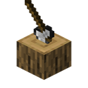
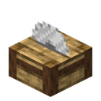
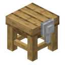
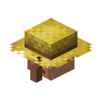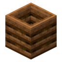
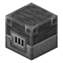
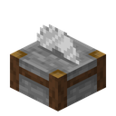
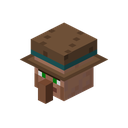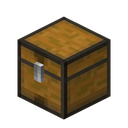
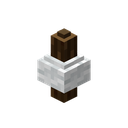
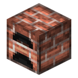
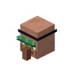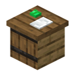
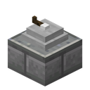
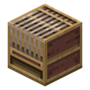
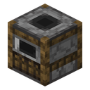
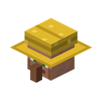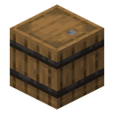
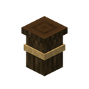
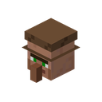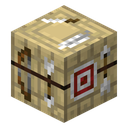

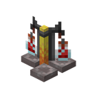
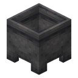
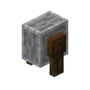
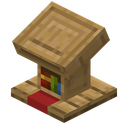

Working Villagers turns villagers into paid employees. You hand them a work
contract, give them a workstation and a few chests, and they start working: felling
trees, sawing planks, crafting chests, farming fields, smelting ore, digging pits and tunnels, firing
glass and bricks, selling goods to the villagers and carrying items from one place to
another.
There are no machines: everything is done by villagers walking around, opening chests
and working at their stations.

!!! warning "Beta"
    This is an early beta for testing. Back up your worlds before trying it, and expect
    that saves may not carry over to later versions. See [Beta notes](beta.md).

## The workers

[[workers]]

Every worker needs emeralds :mc-emerald: as its wage. Right-click it with them; it takes
one emerald each day, but only on a day it gets something done. No wage, no work. Hired late in the afternoon (in the last third of
the work hours), a worker works the rest of that first day for free.

## How it works in short

<ol class="wv-steps">
<li>:mc-work_contract:<strong>Hire</strong> Craft a work contract and right-click a villager with it.</li>
<li>:mc-chopping_block:<strong>Workstation</strong> Place a workstation. The villager walks there and takes the job.</li>
<li>:mc-chest:<strong>Chests</strong> Link chests: where the material comes from and where the products go.</li>
<li>:mc-emerald:<strong>Wage</strong> Right-click the worker with emeralds (and its tool, if it needs one).</li>
<li>:mc-clock:<strong>Work</strong> During the day the villager works on its own. Its menu shows what it is doing.</li>
</ol>

New here? Start with [Installation](installation.md) and then
[Your first worker](getting-started.md), which walks you through your first lumberjack.

## Features at a glance

- Seven professions that work together: a lumberjack feeds a sawyer, a carrier brings the
  planks to a carpenter.
- Workers really walk to chests, open them and work at their stations, with sounds and
  particles.
- Hired villagers find a free workstation by themselves, never take vanilla jobs and
  never leave their job by themselves.
- The menus show what each worker is doing right now: chopping 40 %, waiting for wages,
  done for today, sleeping, ...
- Lumberjacks only touch natural trees, so your log houses are safe.
- New: the **woodcutter** :mc-woodcutter:, a stonecutter for wood, and the
  **carpenter's bench** :mc-carpenter_bench:, a crafting table for wooden things. Both are
  useful for players too.
- Woodcutter recipes and carpenter products are data driven, so data packs and other
  mods can add their wood. The sawyer's orders only know the vanilla wood types.
- Wage, speeds, distances and limits can be set in a [config file](configuration.md).
- Works on Fabric and NeoForge, in singleplayer and on servers.
